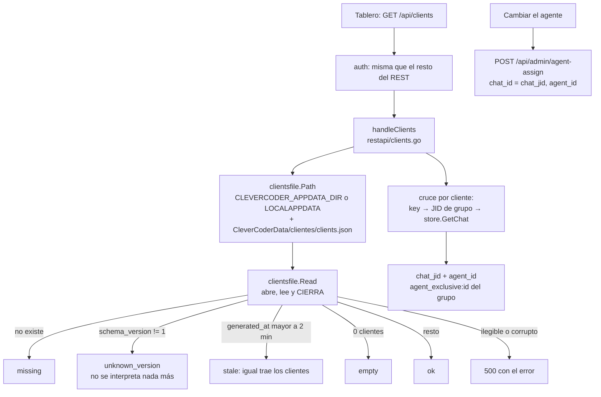

# T172c — backend de la pestaña Clientes

Contrato: `ct-2026-11-10-2254-t172c` (hijo de T172; esquema en sus notas 3 y 4, la 4
corrige a la 3). Un cliente de CleverCoder = un chat de grupo. Piumy solo LEE
`clients.json`; la UI es de Ópalo (T172d) y se escribe contra la respuesta de abajo.

## Flujo



## Respuesta de `GET /api/clients` (el contrato para T172d)

```json
{
  "status": "missing | empty | stale | unknown_version | ok",
  "generated_at": "2026-11-10T22:10:00-03:00",
  "clients": [
    {
      "key": "555000000000001", "name": "Grupo Uno", "state": "abierto",
      "week": {"lines": {"used": 120, "limit": 500}, "cost_usd": {"used": 1.25, "limit": 10}},
      "...": "el resto de los campos del archivo, tal cual",
      "chat_jid": "555000000000001@g.us",
      "agent_id": "term-a"
    }
  ]
}
```

- `clients` es siempre un arreglo (`[]` si no hay), nunca `null`.
- `missing` y `unknown_version`: `generated_at` vacío y `clients` vacío.
- `stale`: la última foto, con sus clientes (la UI avisa «no está al día, última foto: …»).
- Los campos del archivo pasan tal cual (los números sin tocar); Piumy no interpreta
  ninguno salvo `key`. Suma DOS campos propios:
  - `chat_jid`: el grupo de Piumy que corresponde al cliente, o `""` si Piumy no lo conoce
    (o la clave no es un grupo).
  - `agent_id`: el agente asignado a ESE grupo con `agent-assign` (`agent_exclusive:<id>`),
    `""` si no hay asignación manual (entonces el despacho cae a la ruta, al agente por defecto
    de grupos o al principal).
- Error de lectura o archivo corrupto: HTTP 500 `{"error": "..."}` — no hay un sexto estado.

**Cambiar el agente principal del grupo:** `POST /api/admin/agent-assign` con
`{"chat_id": <chat_jid>, "agent_id": <id>}` (`""` quita la asignación). Alcanza, no se
crea endpoint. Solo con `chat_jid` no vacío: asignar un chat que Piumy no tiene no hace nada.

## Decisiones

- **`key` no es exactamente el JID.** CleverCoder clave al cliente por la primera parte del
  `de:` que escribe Piumy, y `capipush.envelopeFrom` pone ahí la PARTE DE USUARIO del JID
  (`jidNumber`: `<dígitos>`, sin `@g.us`). El esquema dice «JID del grupo»; el cruce acepta
  las dos formas (`<dígitos>` → `<dígitos>@g.us`, o el JID completo) y devuelve el `chat_jid`
  resuelto para que la UI no tenga que reconstruirlo.
- **Un paquete chico y solo de archivo** (`internal/clientsfile`): sabe leer y clasificar
  `clients.json`, nada de Piumy. El cruce con el store vive en el handler.
- **La versión se mira ANTES de interpretar el resto**: un archivo de una versión futura puede
  traer `clients` con otra forma; no debe dar error sino `unknown_version`. `schema_version`
  distinto de 1 (también ausente o 0) es `unknown_version`: no es un formato que conozcamos.
- **Abrir, leer, cerrar** (`os.ReadFile`): Go abre sin `FILE_SHARE_DELETE` en Windows, así que
  mientras Piumy lo tiene abierto CleverCoder salta esa escritura; por eso la ventana es de
  milisegundos y nunca se retiene el archivo.
- **Sin el archivo = `missing`**, también en Linux/macOS (no hay `%LOCALAPPDATA%`): el archivo
  solo existe con CleverCoder en el mismo PC.
