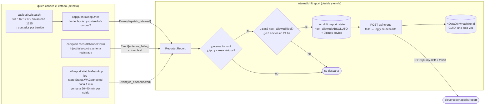

# T174a — reportes de drift (diagrama)

Contrato `ct-2026-11-10-210158-t174a`. Un reporte es una nota corta y anónima
a los mantenedores cuando lo que Piumy cree difiere de lo que pasa de verdad.
El paquete `internal/driftreport` hace UNA cosa: recibe un `Event`, decide si
puede salir (interruptor, ventana por tipo, tope diario, todo persistido) y lo
manda. **Detectar** el drift es de quien ya conoce el estado.



## Reglas que el código hace cumplir

- **El tope persiste** (`kv`, que `ResetMessagingData` no toca) y guarda el
  `next_allowed` ya sorteado (6–9 h): un bucle de reinicios no vuelve a tirar
  los dados. El máximo diario es una ventana móvil de 24 h, no un día de calendario.
- **El cupo se reserva ANTES de enviar**: un envío que falla no se reintenta
  y un reinicio a mitad del envío no puede duplicarlo.
- **Nunca sale texto libre**: `Event` solo lleva `Kind` y `Cause` (vocabulario
  cerrado, lo demás se descarta), un conteo y una duración. Ni JID, ni
  teléfono, ni nombre, ni texto de chat, ni rutas.
- **Apagado = cero efectos**: sin interruptor no se lee el KV, no se crea
  `machine-id` y no se hace ninguna petición.
- **El interruptor y su valor por defecto viven en UNA constante**
  (`config.driftReportsDefault`): la decisión del boss (opt-in o encendido) es
  cambiar esa línea.

## Por qué el vigía de WhatsApp lee el estado y no engancha whatsmeow

`WAConnected` tiene tres escritores (`inbound.go:182`, `:324`, `adapter.go:619`).
`scheduleReconnect` no ve las caídas terminales (LoggedOut/StreamReplaced/
ClientOutdated/ConnectFailure solo llaman `handleDisconnect`) y `handleDisconnect`
no ve el arranque sin red. Leer `state.Status` cubre los dos caminos sin tocar
el paquete más delicado. "No pareado" (`ShowQR`, mood `qr`, `OwnJID` vacío) no
es drift y se excluye.

## Fragmento para el tablero (lo pega Ópalo en T172b, tramo Opciones)

Los reportes son **opcionales y apagados por defecto**; el tablero es donde el
usuario los enciende y **tiene que decir qué sale y qué nunca sale** junto al
interruptor. El backend ya está (`GET`/`POST /api/admin/drift-reports`, ver
`docs/MANUAL.md`, nodo `driftreport`): `GET` → `{"enabled": bool, "url": "…"}`,
`POST {"enabled": bool}` → lo mismo. Aplica en el acto, sin reiniciar.

Lo de abajo se validó aplicándolo al `index.html`/`app.js`/`catalog.go` de
`HEAD` en una copia aislada y corriendo `go test ./internal/i18n/` (que exige
que cada clave del catálogo la use alguien, y que cada `data-i18n` exista en
los dos idiomas). Las claves y el HTML hay que pegarlos JUNTOS: el catálogo
solo no pasa ese test, por eso no están en el árbol todavía.

**HTML** — en el modal de Opciones (`#configmodal`), con el mismo patrón que
"Espera antes de despachar" o "Idioma". Ópalo lo adapta a su rediseño; lo que
importa es que el texto de qué sale / qué nunca sale quede VISIBLE junto al
interruptor, no escondido detrás de un enlace:

```html
<!-- T174a (ct-2026-11-10-210158): reportes de drift — voluntarios y APAGADOS
     por defecto. El interruptor y lo que sale / lo que nunca sale van JUNTOS:
     no se muestra uno sin lo otro. -->
<div class="divider"></div>
<p class="modal-sub" data-i18n="modal.drift_heading">Reportes de drift</p>
<p class="dimnote" data-i18n="modal.drift_intro">Cuando lo que Piumy cree difiere de lo que pasa de verdad —despachos retenidos porque nadie puede recibirlos, WhatsApp desconectado mucho rato, una antena que no responde— puede mandar un aviso corto a los desarrolladores. Es voluntario: viene apagado y solo sale si lo activas aquí.</p>
<p class="modal-sub" data-i18n="modal.drift_sent_label">Qué sale</p>
<p class="dimnote" data-i18n="modal.drift_sent">El tipo de problema, cuántas veces ocurrió, cuánto duró, la versión de Piumy, el sistema operativo y la arquitectura, y un identificador aleatorio de esta instalación.</p>
<p class="modal-sub" data-i18n="modal.drift_never_label">Qué nunca sale</p>
<p class="dimnote" data-i18n="modal.drift_never">Ningún número de teléfono, nombre, contacto, mensaje ni chat, ni rutas de tu disco, ni claves. Esto está fijado en el código del programa: no depende de esta pantalla.</p>
<p class="dimnote" data-i18n="modal.drift_limits">Como máximo 3 al día, y uno de cada tipo cada 6 a 9 horas. Si el envío falla, se descarta.</p>
<p class="dimnote"><span data-i18n="modal.drift_destination">Destino</span>: <span id="config_drift_url"></span></p>
<div class="field"><label><input type="checkbox" id="config_drift_enabled"> <span data-i18n="modal.drift_switch">Enviar reportes de drift a los desarrolladores</span></label></div>
<div class="field"><button class="btn pri block" type="button" id="config_drift_save" data-i18n="action.save">Guardar</button></div>
<p id="config_drift_result" class="result"></p>
```

**JS** — al abrir Opciones (junto a la carga de `dispatch-debounce`) y al guardar
(junto a `config_debounce_save`); `api()`, `post()` y `t()` ya existen:

```js
// al abrir Opciones:
document.getElementById("config_drift_result").textContent = "";
api("/api/admin/drift-reports").then(function (d) {
  document.getElementById("config_drift_enabled").checked = !!d.enabled;
  if (d.url) document.getElementById("config_drift_url").textContent = d.url;
}).catch(function () {
  document.getElementById("config_drift_enabled").checked = false;
});

// al guardar:
document.getElementById("config_drift_save").addEventListener("click", function () {
  var result = document.getElementById("config_drift_result");
  post("/api/admin/drift-reports", { enabled: document.getElementById("config_drift_enabled").checked }).then(function () {
    result.textContent = t("action.saved");
  }).catch(function (e) {
    result.textContent = t("error.prefix") + e.message;
  });
});
```

**Catálogo** (`internal/i18n/catalog.go`, junto a las otras `modal.*`), ES y EN. Cada
clave de aquí la usa el HTML de arriba, y ninguna existe todavía en el catálogo
(`modal.drift_*`):

| clave | ES | EN |
|---|---|---|
| `modal.drift_heading` | Reportes de drift | Drift reports |
| `modal.drift_intro` | (el texto de `.dimnote` de arriba) | When what Piumy believes differs from what is really happening — dispatches held because nobody can receive them, WhatsApp disconnected for a long while, an antenna that does not answer — it can send the developers a short note. It is voluntary: it ships switched off and only goes out if you turn it on here. |
| `modal.drift_sent_label` | Qué sale | What is sent |
| `modal.drift_sent` | (ídem) | The kind of problem, how many times it happened, how long it lasted, the Piumy version, the operating system and architecture, and a random identifier of this installation. |
| `modal.drift_never_label` | Qué nunca sale | What is never sent |
| `modal.drift_never` | (ídem) | No phone number, name, contact, message or chat, no paths on your disk, no keys. This is fixed in the program's code: it does not depend on this screen. |
| `modal.drift_limits` | (ídem) | At most 3 a day, and one of each kind every 6 to 9 hours. If sending fails, the report is dropped. |
| `modal.drift_destination` | Destino | Destination |
| `modal.drift_switch` | Enviar reportes de drift a los desarrolladores | Send drift reports to the developers |

Cada frase de "qué sale" / "qué nunca sale" describe lo que el CÓDIGO de
`internal/driftreport` ya hace cumplir (vocabularios cerrados, sin campo de texto
libre); si ese código cambia, estos textos y la entrada del MANUAL cambian
con él.
