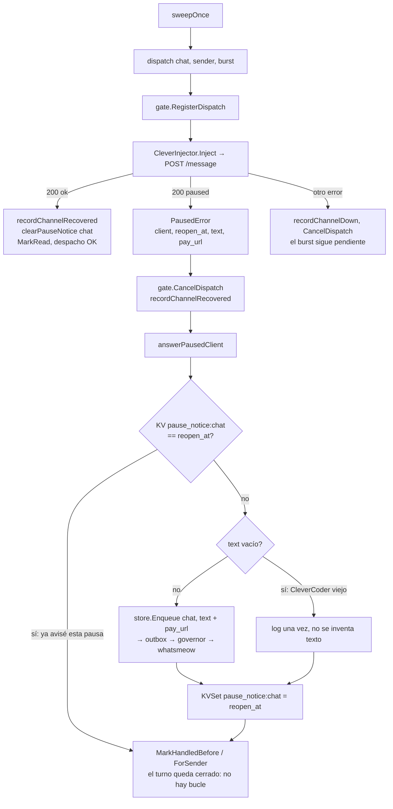

# T175 — cliente pausado por CleverCoder: contestar en vez de callar

Contrato: `ct-2026-11-10-2019-t175`. Un cliente de CleverCoder = un chat de grupo
(palabra del boss); la clave que usa CleverCoder es el id del chat (lo primero
del `de:` del encabezado), pero Piumy no la necesita: ya sabe el `chatJID`.

## Qué pasa hoy en CleverCoder (leído de su código, no supuesto)

`ExternalAgentApiService.cs:1345`: con el cliente pausado, `/message` contesta
`200 {"ok":true,"paused":true,"client":<clave>,"reopen_at":<ISO 8601 con offset>}` y
**no inyecta nada** (ni despierta a un agente dormido). `text` y `pay_url` los suma
CleverCoder en su ct-2026-11-10-2142 (al leer esto todavía no estaban en el árbol):
Piumy tolera su ausencia.

## Flujo

## Decisiones

- **El error lleva la pausa, la interfaz `Injector` no cambia.** `Inject` ya devuelve
  `error` y hay 3 implementadores + el endpoint de prueba; una pausa es «no se entregó,
  por diseño de CleverCoder». `*PausedError` (`errors.As`) en vez de cambiar la firma.
- **Una pausa = un `reopen_at`.** El marcador KV guarda el `reopen_at` del último aviso
  de ese chat. Mismo `reopen_at` → silencio (cierra el turno, no manda nada). Otro
  `reopen_at` → pausa nueva → aviso nuevo. Sin `reopen_at` el marcador es `-`.
- **Un despacho que SÍ llega borra el marcador.** Si el boss reabre («Reabrir ahora»,
  tope más alto) y el cliente se vuelve a agotar la misma semana, el `reopen_at` es el
  mismo: sin este borrado la segunda pausa quedaría en silencio, el defecto que T175
  arregla.
- **`pay_url` no se repite.** El texto por defecto de CleverCoder ya trae el enlace de pago
  dentro; se agrega `pay_url` solo si el texto no lo contiene.
- **Camino normal de salida:** `store.Enqueue` → outbox → governor/anti-ban → adaptador,
  el mismo de `notifyAgentUnreachable`. Sin texto propio de Piumy: no hay claves i18n.
- **No se manda recibo de lectura** en la pausa: ningún agente leyó el mensaje.
- **No se cuenta como redespacho**: el tope `MaxRedispatch` es para turnos que el agente
  recibió y no cerró; acá no llegó a ninguno.

## Parte 2 — `quota_exceeded` / `quota_reset` (solo investigación)

CleverCoder los deja en una bandeja y cada minuto los manda con `CapiClient` al destino
guardado `piumy` (conectado con pin). Eso es un cliente cAPI: necesita una **antena cAPI de
entrada** en el destino (`/handshake` + `/message` sellado).

Piumy no tiene ninguna: solo abre dos puertos, MCP (`main.go:242`, con token Bearer) y REST
(`main.go:246`), y `/handshake` / `/message` solo aparecen como llamadas de Piumy hacia
CleverCoder (`clever_injector.go:197,300`). Los dos mensajes **no llegan**; por eso 0
coincidencias de `quota_` en el Go de Piumy.
