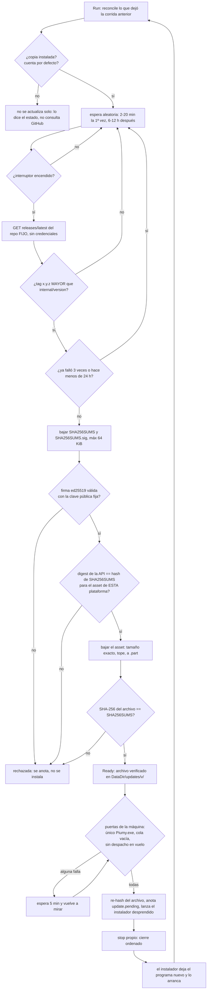

# T176 — Piumy detecta versiones nuevas y se actualiza solo

Contrato: `ct-2026-11-10-2103-t176`. Boss, verbatim: *«que piumy detecte actualizaciones,
y se actualice solo»*. Encendido por defecto; el dueño lo apaga desde el tablero.

Tres piezas, cada una con una sola responsabilidad:

| Pieza | Qué hace | Quién la usa |
|---|---|---|
| `internal/releasesig` | formato de `SHA256SUMS` + firma ed25519 (solo stdlib) | Piumy y la herramienta de firma |
| `cmd/signrelease` | firma una release (`keygen`, `sign`); la clave privada solo de `PIUMY_RELEASE_SIGNING_KEY` | el mantenedor, con `vault_run` |
| `internal/autoupdate` | chequear, verificar, bajar, esperar un momento quieto, lanzar el instalador | `main.go` |

## Flujo



## Qué es cada garantía y dónde vive

- **Autenticidad: la firma.** Piumy trae la clave pública (`internal/autoupdate/pubkey.go`). Sin firma
  válida sobre `SHA256SUMS`, no se confía en ningún hash de ese archivo. El digest que publica GitHub
  prueba integridad, no autenticidad: quien robe el token de publicación sube asset y digest nuevos.
- **Integridad, tres veces:** firma → digest de la API (tiene que existir y coincidir con `SHA256SUMS`) →
  SHA-256 del archivo bajado.
- **Y una cuarta, justo antes de ejecutar (`verifyReady`)**, desde lo guardado y no de la memoria de la
  vuelta anterior: el `SHA256SUMS` y la firma que quedaron en el estado se vuelven a verificar con la clave
  pública, el paquete tiene que estar donde el actualizador lo puso y su hash de HOY tiene que ser el que el
  archivo firmado lista. Un estado manipulado (otro `File`, un hash editado, un `SHA256SUMS` cambiado) no
  pasa sin la clave de release.
- **El repo es una constante** (`clevercat64/Piumy`); la URL de descarga se arma en código con el tag y
  el nombre exacto del asset (`Piumy-Setup-<v>.exe` o `Piumy-<v>-<os>-<arch>.tar.gz`). La
  `browser_download_url` del JSON no se usa nunca.
- **Solo hacia adelante:** versión estricta `x.y.z`, solo si es MAYOR. Un `SHA256SUMS` viejo y válido no
  sirve para una release nueva: los nombres llevan la versión.
- **Solo en una copia instalada** (Windows: `unins000.exe` junto al ejecutable; Linux/Mac: el binario es
  `DataDir/piumy-gateway` y corre como servicio). Un Piumy de desarrollo nunca baja ni corre un instalador.
- **Solo la cuenta por defecto y el único Piumy.exe** (Windows): el instalador mata TODOS los `Piumy.exe`
  y relanza solo la cuenta por defecto; actualizar con otra cuenta viva las apagaría.
- **Solo con la cola vacía y sin despacho en vuelo:** 0 mensajes pendientes, 0 en el outbox, ningún
  terminal con un despacho vivo.
- **Sin bucles:** 3 intentos por versión como máximo y 24 h entre intentos (verificación rechazada,
  instalación que no se aplicó, o instalador que no arrancó).

## Relanzar (medido en T176, informe a Citrino)

- **Windows.** Piumy NO se relanza solo: el Setup ya mata al viejo (`taskkill /F`, verificado) ANTES de
  copiar y arranca el nuevo al final, también en `/VERYSILENT`. Relanzar desde Piumy antes de que el viejo
  muera es el riesgo: el mutex de T59 hace que la 2ª instancia salga en silencio y no quedaría ninguna.
  Piumy lanza un `update.cmd` desprendido (`CREATE_NO_WINDOW | CREATE_NEW_PROCESS_GROUP`, sin breakaway:
  el job de CleverCoder lo rechaza) que corre el Setup con `start /wait` y, cuando termina, vuelve a
  lanzar Piumy.exe SOLO si no hay ninguno corriendo. Así un Setup que falla después de matar al viejo no
  deja el gateway apagado; si ya hay uno, el mutex de T59 hace inofensivo un segundo arranque.
- **Linux.** `install.sh` hace `systemctl --user stop`, que mata el servicio con sus hijos (cgroup): si
  Piumy lo lanzara como hijo, moriría a mitad. Se lanza con `systemd-run --user --collect` (unidad
  transitoria, su propio cgroup).
- **macOS.** `launchctl bootout` mata el grupo de procesos del trabajo: se lanza con `Setsid`.

## Estado y qué muestra el tablero

Persistido en KV (`autoupdate.state`, un JSON): última versión vista, cuándo se miró, el archivo listo, la
versión que se está instalando (`pending`), la última instalada y cuándo, y los intentos fallidos.
El proceso nuevo, al arrancar, compara `pending` con su propia versión: igual → «instalada» con fecha;
menor → «no se aplicó», cuenta como intento fallido.

`GET /api/update` y `POST /api/admin/auto-update {"enabled": bool}`; ver el fragmento para Ópalo más abajo.

## Poner en marcha (lo que falta de tu lado)

1. **Generar la clave, una vez:** `go run ./cmd/signrelease keygen`. La línea `PRIVADA` va al vault y a
   ningún otro lado; la `PUBLICA` se pega en `internal/autoupdate/pubkey.go` (`releasePublicKey`).
   **Mientras esa constante esté vacía, Piumy no instala nada** (ve la versión nueva y dice que no puede
   verificarla): es la forma segura de estar sin configurar. La primera versión con el actualizador tiene que
   salir con la clave ya puesta, o esas instalaciones nacen sin poder actualizarse.
2. **En cada release**, con los archivos ya armados en `dist/` (`build-all.sh` + el Setup):
   `vault_run <módulo con PIUMY_RELEASE_SIGNING_KEY> go run ./cmd/signrelease sign dist dist/Piumy-Setup-<v>.exe dist/Piumy-<v>-*.tar.gz`.
   Escribe `dist/SHA256SUMS` y `dist/SHA256SUMS.sig`: **subir esos dos archivos con los paquetes**. La herramienta
   imprime la clave pública con la que firmó: tiene que ser la de `pubkey.go`.
3. Las instalaciones que ya corren (≤ 0.12.5) no traen el actualizador: se actualizan a mano UNA vez. Una release
   sin `SHA256SUMS.sig` (como la 0.12.5) nunca se instala sola: lo rechaza el código, queda anotado.
4. «Immutable releases» de GitHub (hoy `"immutable": false`) queda aparte.

## Lo que se midió

- **GitHub:** `GET /repos/clevercat64/Piumy/releases/latest` sin credenciales: 200, repo público, 60/h por IP;
  los 6 assets traen `digest: sha256:…` y coincide con el SHA-256 real de los dos que se bajaron.
- **Windows (procesos reales, 6 casos):** sin job, un hijo sobrevive a que maten a su padre; dentro de un job como
  el de CleverCoder (`KILL_ON_JOB_CLOSE` sin `BREAKAWAY_OK`) el hijo muere aunque sea `DETACHED`, y
  `CREATE_BREAKAWAY_FROM_JOB` da «Acceso denegado». El wrapper (`update-<v>.cmd`) se probó de verdad, desprendido y
  en una ruta con espacios, con programas de mentira: si el Setup falla y no queda ningún Piumy, lo vuelve a
  lanzar; si el Setup ya lo relanzó, no arranca otro. Esa prueba **encontró un defecto real**: con Git Bash en el
  `PATH`, `find` era el de GNU y el chequeo «¿corre Piumy?» siempre decía no (por eso el wrapper llama a las
  herramientas por `%SystemRoot%\System32\`).
- **Linux real (Ubuntu 24.04, kernel 6.18 WSL2, systemd 255, usuario normal: `install.sh` se niega a correr como
  root y WSL entrega `root`, se creó un usuario temporal y se borró):**
  - CONTROL, `install.sh` lanzado como hijo del servicio: `systemctl --user stop` lo mata (`Terminated` en su
    log), el servicio queda inactivo, no se reinicia (`Restart=on-failure` no reinicia un `stop`) y el binario
    sigue en la versión vieja.
  - CAMINO REAL (`platformLaunch`: extraer el `tar.gz` y `systemd-run --user --collect`), lanzado desde dentro
    del servicio: el instalador sobrevive, el binario pasa a la versión nueva, el servicio responde ~3 s después,
    el log dice «Piumy quedó actualizado y corriendo», no queda ninguna unidad transitoria y
    `piumy-config.json` queda intacto.
  - La suite de `autoupdate` compilada para Linux, corrida como usuario normal: verde, incluido
    `TestShellWrapper…`, que en Windows se salta (necesita `/bin/sh`).
  - El sistema quedó como estaba (`/etc/passwd` y `/etc/group` con el mismo hash, `/home` igual); el WSL se apagó.
- **macOS: NO probado.** `Setsid` se apoya en que launchd mata por grupo de procesos y el `plist` de `install.sh`
  no trae `AbandonProcessGroup`; es lo que dice la documentación, no lo que se vio.

## Fragmento para el tablero (lo pega Ópalo, en Opciones, junto al interruptor de drift)

Backend listo: `GET /api/update` → `autoupdate.Status` y `POST /api/admin/auto-update {"enabled": bool}` → el
mismo `Status`. Aplica en el acto, sin reiniciar. El servidor manda **códigos y datos, no texto**; las frases las
arma la UI con claves del catálogo (el orden de las palabras cambia entre idiomas). `failure` (el motivo, en
español, del registro) NO se muestra en pantalla.

Se validó igual que el de T174a: aplicado al `index.html` / `app.js` / `catalog.go` de `HEAD` en una copia aislada,
`go test ./internal/i18n/` en verde (y rojo cuando se le quita una clave inglesa, para saber que el test puede
fallar), y `node --check` sobre el `app.js`. Las claves y el HTML hay que pegarlos JUNTOS: el catálogo solo no
pasa el test que exige que cada clave la use alguien.

**HTML** — justo después de `<p id="config_drift_result" class="result"></p>`:

```html
        <!-- T176 (ct-2026-11-10-2103): auto-actualización — ENCENDIDA por defecto
             (boss: "que piumy detecte actualizaciones, y se actualice solo").
             El estado sale del servidor (GET /api/update); el interruptor es
             POST /api/admin/auto-update. -->
        <div class="divider"></div>
        <p class="modal-sub" data-i18n="modal.update_heading">Actualizaciones</p>
        <p class="dimnote" data-i18n="modal.update_intro">Piumy busca versiones nuevas y las instala solo, cuando no hay mensajes pendientes. Antes de instalar verifica la firma de la versión: si algo no cuadra, no instala.</p>
        <p class="dimnote" id="config_update_status"></p>
        <div class="field">
          <label class="switch-row" for="config_update_enabled">
            <span data-i18n="modal.update_switch">Actualizar Piumy automáticamente</span>
            <input type="checkbox" id="config_update_enabled">
          </label>
        </div>
        <div class="field"><button class="btn pri block" type="button" id="config_update_save" data-i18n="action.save">Guardar</button></div>
        <p id="config_update_result" class="result"></p>
```

**JS** — tres trozos. (1) La función, junto a `fmtClientStamp`:

```js
  // T176: la frase de estado de la auto-actualización, armada con claves del
  // catálogo (el orden de las palabras cambia entre idiomas, nunca se pega a
  // mano). El servidor manda códigos y datos, no texto: u.blocked es uno de
  // "busy", "other_instance", "no_key"; u.failure (el motivo, en español, es
  // del registro) NO se muestra: la frase solo dice que falló.
  function updateStatusText(u) {
    var parts = [];
    if (!u.supported) {
      parts.push(t("modal.update_state_unsupported"));
    } else if (u.pending) {
      parts.push(t("modal.update_state_installing", { pending: u.pending }));
    } else if (u.available && u.given_up) {
      parts.push(t("modal.update_state_failed", { latest: u.latest }));
    } else if (u.available && u.blocked === "no_key") {
      parts.push(t("modal.update_state_nokey", { latest: u.latest }));
    } else if (u.available && u.ready) {
      parts.push(t("modal.update_state_ready", { latest: u.latest }));
      if (u.blocked === "busy") parts.push(t("modal.update_blocked_busy"));
      if (u.blocked === "other_instance") parts.push(t("modal.update_blocked_other_instance"));
    } else if (u.available) {
      parts.push(t("modal.update_state_found", { latest: u.latest }));
    } else {
      parts.push(t("modal.update_state_current", { current: u.current }));
    }
    if (u.installed_version) {
      var when = new Date(u.installed_at * 1000).toLocaleString(clientLang(), { day: "numeric", month: "short", hour: "2-digit", minute: "2-digit" });
      parts.push(t("modal.update_installed", { version: u.installed_version, when: when }));
    }
    return parts.join(" ");
  }
```

(2) Al abrir Opciones, justo después de la carga de `drift-reports`:

```js
    // T176: estado real de la auto-actualización, leído del servidor cada vez
    // que se abre Opciones — nunca se asume. Si la lectura falla, el interruptor
    // queda apagado y sin frase: decir "al día" sin saberlo sería mentir.
    document.getElementById("config_update_result").textContent = "";
    api("/api/update").then(function (u) {
      document.getElementById("config_update_enabled").checked = !!u.enabled;
      document.getElementById("config_update_status").textContent = updateStatusText(u);
    }).catch(function () {
      document.getElementById("config_update_enabled").checked = false;
      document.getElementById("config_update_status").textContent = "";
    });
```

(3) El guardado, junto al de `config_drift_save`:

```js
  // T176: encender o apagar la auto-actualización. Aplica en el acto del lado
  // del servidor, sin reiniciar; acá solo se manda la decisión, se dice si
  // quedó guardada y se repinta la frase de estado con lo que contestó.
  document.getElementById("config_update_save").addEventListener("click", function () {
    var result = document.getElementById("config_update_result");
    post("/api/admin/auto-update", {
      enabled: document.getElementById("config_update_enabled").checked,
    }).then(function (u) {
      document.getElementById("config_update_status").textContent = updateStatusText(u);
      result.textContent = t("action.saved");
    }).catch(function (e) {
      result.textContent = t("error.prefix") + e.message;
    });
  });
```

**Catálogo** (`internal/i18n/catalog.go`, junto a las `modal.drift_*`), ES y EN:

| clave | ES | EN |
|---|---|---|
| `modal.update_heading` | Actualizaciones | Updates |
| `modal.update_intro` | Piumy busca versiones nuevas y las instala solo, cuando no hay mensajes pendientes. Antes de instalar verifica la firma de la versión: si algo no cuadra, no instala. | Piumy looks for new versions and installs them by itself, when no messages are pending. Before installing it checks the version's signature: if anything does not add up, it does not install. |
| `modal.update_switch` | Actualizar Piumy automáticamente | Update Piumy automatically |
| `modal.update_state_current` | Piumy {current} está al día. | Piumy {current} is up to date. |
| `modal.update_state_found` | Hay una versión nueva ({latest}); se está verificando. | There is a new version ({latest}); it is being verified. |
| `modal.update_state_ready` | La versión {latest} está verificada y se instala sola en cuanto no haya mensajes pendientes. | Version {latest} is verified and will install itself as soon as no messages are pending. |
| `modal.update_state_installing` | Instalando la versión {pending}… | Installing version {pending}… |
| `modal.update_state_failed` | La versión {latest} no se pudo instalar (3 intentos). Piumy la deja de lado hasta que salga una más nueva; el motivo está en el registro. | Version {latest} could not be installed (3 tries). Piumy sets it aside until a newer one comes out; the reason is in the log. |
| `modal.update_state_nokey` | Hay una versión nueva ({latest}), pero esta Piumy no puede verificarla: actualiza a mano. | There is a new version ({latest}), but this Piumy cannot verify it: update by hand. |
| `modal.update_state_unsupported` | Esta copia de Piumy no se actualiza sola (es una copia de desarrollo, o no es la cuenta principal). | This copy of Piumy does not update itself (it is a development copy, or not the main account). |
| `modal.update_blocked_busy` | Esperando un momento sin mensajes pendientes. | Waiting for a moment with no pending messages. |
| `modal.update_blocked_other_instance` | Hay otra cuenta de Piumy abierta: ciérrala para que se pueda actualizar. | Another Piumy account is open: close it so this one can update. |
| `modal.update_installed` | Última instalación: {version}, {when}. | Last install: {version}, {when}. |

