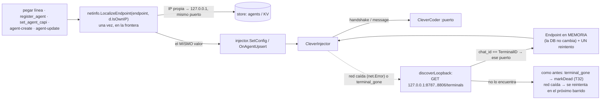

# T177 — la antena en el mismo PC: loopback, y el puerto que se mueve

Contrato: `ct-2026-11-10-2142`. Origen: medición de Quartz (CleverCoder) sobre este
repo, vía la antena del Citrino de CleverCoder. Es la causa de fondo de los
despachos retenidos con «Destino viejo» en el log.

## Qué pasaba

1. El endpoint de la antena se guardaba tal como se pegaba. Si era la IP de la LAN
   de ESTE PC, el día que el router le daba otra, el endpoint quedaba apuntando a
   nada (o a otra máquina) y los despachos se retenían.
2. CleverCoder abre su antena en el primer puerto libre de 8787..8806. Si el
   puerto cambia de una sesión a otra, el `CleverInjector` (un solo `Endpoint`, sin
   reintento ante conexión rechazada) no la encuentra.
3. Agravante, medido en el código: `handshake()` hace POST de `{terminal_id,
   pinpass}` **en claro**. Con una IP vieja que hoy es de otra máquina de la LAN, el
   pinpass viaja a esa máquina.
4. Riesgo del T32: si el puerto viejo lo sirve ahora OTRO proyecto de CleverCoder y
   contesta `terminal_gone`, el injector se marcaba muerto para siempre (solo un
   `SetConfig` nuevo lo revive).

## Flujo

## Decisiones (y por qué)

- **Loopback al escribir, en la frontera, una vez.** `netinfo.LocalizeEndpoint` es
  una función pura que recibe `isOwn`; solo reescribe una IP **propia y no
  loopback**. Una IP ajena queda igual (el caso Raspberry Pi, S6: el gateway en la
  Pi y el agente en otra máquina de la LAN). El valor ya normalizado va tanto al
  store como a `SetConfig`/`OnAgentUpsert`, porque los llamadores pasaban su
  variable local a los dos: normalizar adentro del store habría dejado el injector
  vivo distinto de la DB hasta reiniciar.
- **`isOwn` entra por `Deps`, no por variable global.** `restapi.Deps.IsOwnIP` y
  `mcpserver.Deps.IsOwnIP` (`nil` = no reescribe), asignados UNA vez en `main.go`
  con `netinfo.IsOwnIP`. Medido: al menos 14 tests existentes pasan por esos bordes
  con `http://192.168.1.x` (uno de ellos afirma que la IP LAN pegada sobrevive,
  S6), y 192.168.1.x es la red doméstica más común: con la búsqueda real cableada
  en el borde, en un equipo que tenga una de esas IPs esos tests cambiarían de
  resultado según las interfaces de la máquina que los corre.
- **Seis puntos de frontera**, cada uno con su test con un `isOwn` de mentira (si se
  olvida uno en el futuro, el test del punto pone rojo): REST — pegar la línea del
  conector, `agent-create` y `agent-update` (los dos localizan antes de separar
  principal/secundario); MCP — `updatePrincipalConnector` (cubre `set_capi_connector`
  y `set_agent_capi` dirigido al principal), `register_agent` y `set_agent_capi`
  sobre un secundario.
- **El descubrimiento solo hace `GET /terminals`, nunca un handshake de sondeo.** Un
  handshake de prueba podría abrir una aprobación en la ventana del boss
  (`two_step`/`approved` aparecen en el listado). Solo mira `127.0.0.1`; nunca la LAN.
  Elige por `chat_id == TerminalID` (único). Corre en el `Inject` y en
  `TestHandshake` (para que «probar conexión» y el tracker no digan «caída» sobre
  una antena que el próximo despacho sí encuentra), **antes** de `markDead`.
- **El endpoint descubierto vive solo en memoria.** La DB conserva lo que el dueño
  registró; cada reinicio re-descubre en el primer fallo. Contra: el tablero puede
  mostrar el puerto registrado y no el vivo.
- **Rango 8787..8806 como constante** (`cleverPortFirst/Last`): es el mismo rango con
  que CleverCoder busca la antena (skill `capi-protocol`, «Send»); no es un ajuste
  del dueño. Si CleverCoder lo cambia, se cambia acá.
- **P2 (las filas viejas) no llevó código.** El boss respondió «Bórralos»;
  Citrino borró `aragonite` y `capi-encirculado-citrino-…` con `delete_agent`
  (ambos `role=secondary`), que des-asigna los chats y NO toca los mensajes.

## Techos declarados (no se arreglan acá)

- **Lo ya guardado no se normaliza.** Las filas existentes y el endpoint por variable
  de entorno (`main.go`, `kvOrEnv`) no pasan por la frontera. El descubrimiento hace
  que el despacho funcione igual, pero el pinpass en claro a una IP vieja seguiría
  yendo en esos casos hasta que alguien re-registre.
- **`send_to_boss` (antena efímera con TTL) no se toca:** no se persiste.
- **`/terminals` no está en `external-agent-protocol.md`.** Se midió en vivo y lo
  reporta el lado de CleverCoder; todo desajuste (otra app, un 404, basura, falta el
  campo) se lee como «no está aquí» y el injector queda exactamente como antes.
- **El cableado de `main.go` no tiene test** (son dos asignaciones `IsOwnIP:
  netinfo.IsOwnIP`); se verificó leyendo el diff y con la comprobación real de abajo.

## Lo medido

- **La premisa que descarté:** medí con `curl` que cada puerto cerrado de loopback
  tardaba 2 s y concluí que en Windows «se cuelgan». Era del `curl` (tarda 2,03 s
  también con `--noproxy` y `connect=0`); con `net.Dial` de Go cada puerto cerrado
  rechaza en 1-41 ms. Por eso el barrido es **secuencial** con un tope de 500 ms por
  sonda (solo importa para un puerto ocupado por algo que acepta y no contesta), y
  no paralelo.
- **Contra el CleverCoder real de este PC** (copia aislada, solo lectura):
  `GET /terminals` responde en 8787, 8788 y 8789 con `{app:"clevercoder-capi",
  protocol, terminals:[{address, approved, chat_id, name, port, project, two_step}]}`;
  la antena de este terminal se encontró en `127.0.0.1:8789` en 115 ms; un barrido
  completo de 20 puertos con un id inexistente: 124 ms; la IP LAN propia →
  `127.0.0.1`, una ajena (documentación) sin cambios.
- **Tests:** `netinfo` (tabla de `LocalizeEndpoint`, `hasIP`, caso conocido de la
  búsqueda real), `capipush` (`discoverLoopback` en tabla, y el injector: puerto
  movido, `TestHandshake`, `terminal_gone` en un puerto ajeno → no muere, sin antena
  en ningún lado → muere (T32), sin hallazgo → se reintenta, un `SetConfig` nuevo gana
  a un barrido en curso, mismo endpoint → sin reintento inútil, `antenna_off` → sin
  barrido), `restapi` y `mcpserver` (cada punto de frontera, y que una IP ajena y un
  `agent-update` sin `endpoint` no se tocan).
- **Sabotaje en copia aislada:** 28 mutaciones (cada una compila y se verifica que
  se aplicó), todas en rojo; los cuatro controles sin mutar, en verde. Hallazgo del
  propio sabotaje: el test que escribí primero NO distinguía una guarda de loopback,
  un `terminalID` vacío, la sesión vieja tras relocalizar ni un reintento inútil;
  se agregaron esos casos y recién ahí murieron.

## NO verificado

- Qué contesta CleverCoder a un handshake sobre un puerto que no es el de ese
  `chat_id` (¿`terminal_gone` o lo resuelve igual?). No se probó a propósito: podría
  abrir una aprobación en la ventana del boss.
- El techo del rango (8806) viene de CleverCoder; se vieron tres puertos en uso.
- Un despacho REAL a través de un puerto movido (haría falta el pinpass y escribiría
  en un terminal vivo); lo cubren los tests con un CleverCoder de mentira.
- `-race` (`CGO_ENABLED=0`, sin `gcc`).
