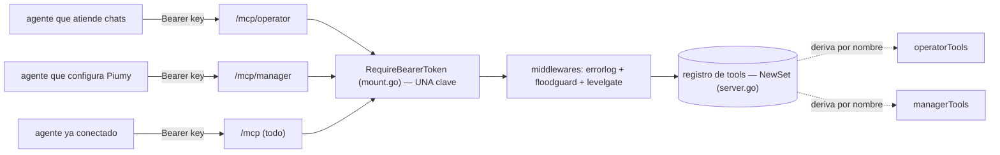

# T178 — MCP en dos perfiles (operator / manager)

Un solo binario, una sola clave, tres puertas. Cada puerta es una vista del
mismo registro de tools (`internal/mcpserver/profiles.go`).

Reglas del reparto:
- Toda tool registrada está en `operatorTools` o `managerTools` (test testigo).
- Se solapan `get_status`, `get_manual` y el triage por chat
  (`set_chat_rules/status/active`, `set_mode`): el manual del operador ya los usa.
- `/mcp` no pierde nada: los agentes ya conectados siguen igual.
- `agent-connect.json` suma `mcp_operator_url` y `mcp_manager_url`.

Pasos siguientes (T178): sacar los candados de configuración, `get_config` /
`set_config`, `gateway_action`, manuales.
