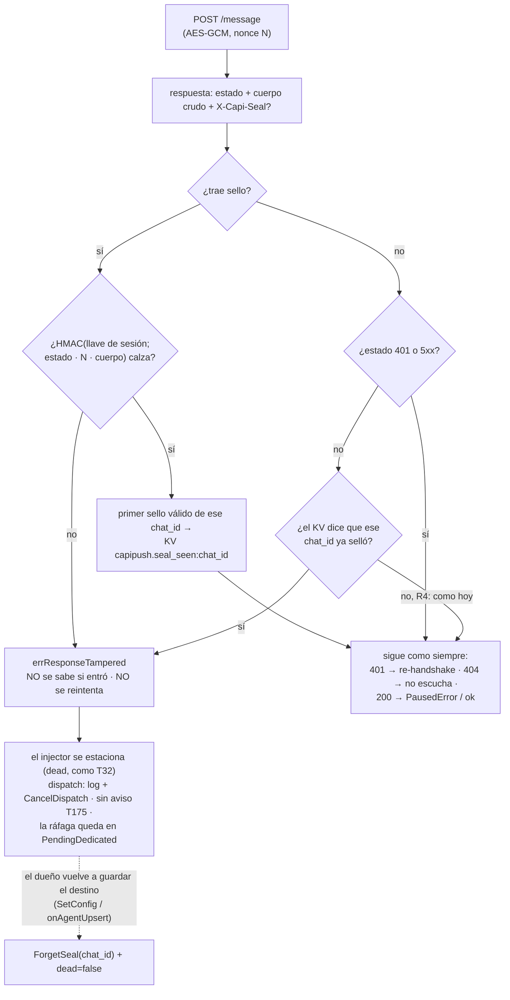

# T179 — verificar el sello `X-Capi-Seal` de las respuestas de CleverCoder

Contrato: `ct-2026-11-10-2336`. Origen: hallazgo de T175 — el `200` de `/message` no iba
sellado, así que alguien entre Piumy y CleverCoder podía cambiar la respuesta.
CleverCoder lo arregló de su lado (su `ct-2026-11-10-2253`, commits `e2927311` y
`7b5c9854` de su master). La especificación es su protocolo §3 «Respuesta sellada»
(`MYClaudeLibrary/Resources/Protocol/external-agent-protocol.md` en su repo).

## Qué pasaba

El AES-GCM del protocolo cubre el **pedido**. La respuesta (`200`, `404`…) viajaba en
claro: un intermediario podía cambiar un `404` por un `200` (el mensaje se da por
entregado y no lo estaba), un `200` por un `404` (Piumy reintenta y el agente recibe el
mensaje dos veces), o fabricar un `{"paused":true,"text":"…"}` con su propio texto, que
T175 publica en el grupo del cliente con el número del dueño.

Medido el 2026-11-11: el CleverCoder instalado (v1.7.1.22, compilado el 10-nov 12:58)
**todavía no manda la cabecera** — ninguno de sus 336 `.dll`/`.exe` contiene
`X-Capi-Seal`, `capi-resp-v1` ni `response_tampered`, y los controles
(`delivery_unavailable`, `invalid_proof`) sí aparecen en los mismos archivos. El sello
está en su master desde después de esa compilación. Hasta que compile, Piumy corre «como
hoy».

## Flujo

## Reglas

El sello es `v1=` + HMAC-SHA256 con la llave `HMAC(llave_de_sesión, "capi-resp-v1")`
sobre `estado "\n" nonce "\n" cuerpo`: estado en decimal, nonce = el string base64
exacto que mandó Piumy, cuerpo = los bytes tal como llegaron (no el JSON vuelto a
armar). Verificado contra el vector oficial del protocolo (llave `00..1f`, `200`,
nonce `AAAAAAAAAAAAAAAA`) y contra el C# de CleverCoder (`CapiPairs.SelloDeRespuesta`).

| | respuesta | resultado |
|---|---|---|
| R1 | trae sello y **no calza** | alterada, siempre (haya o no TOFU) |
| R2 | trae sello y calza | se acepta; si es el primero de ese `chat_id`, se persiste |
| R3 | sin sello, el destino ya selló alguna vez | alterada — **salvo `401` y `5xx`** |
| R4 | sin sello, nunca selló | como antes de T179 |

La excepción de R3 sale del servidor de CleverCoder, no de una suposición: el `401
invalid_token` (token que no es de ninguna sesión → no hay llave) y sus excepciones se
mandan **sin** sello por diseño. Exigirlos pararía al destino cada vez que CleverCoder
se reinicia o la antena se vuelve a encender.

## Decisiones (y por qué)

- **El estado vive en el KV, por `chat_id` de la antena** (`capipush.seal_seen:<chat_id>`
  = hora del primer sello válido; mismo patrón que `capipush.pause_notice:`). No en el
  injector (se **reconstruye** en cada upsert de agente), no por `agent_id`
  (`PromoteToPrincipal` mueve las credenciales entre ranuras), no en una tabla nueva. El
  `chat_id` es el de la antena, no el `terminal_id` de ruteo de Piumy.
- **`NewCleverInjector` recibe `seals KV` como 4º parámetro** (`nil` = sin memoria). Los 4
  sitios de `main.go` lo pasan; un quinto sitio que lo olvide tiene que escribir `nil` a
  la vista. `KV` es la misma interfaz de dos métodos de `autoupdate` y `driftreport`.
- **Si no calza: se estaciona el destino, no se cierra la ráfaga.** El mensaje ya se
  mandó y no se sabe si entró. Hoy cualquier error cae en el reintento sin tope de
  `dispatch` (cada barrido de 5 s): un sello malo se reenviaría una y otra vez y el
  agente podría contestar dos veces. El injector se marca `dead` (el mecanismo de T32:
  `Configured()=false`), los barridos siguientes pasan por la ruta «sin antena» que ya
  existe, y la ráfaga queda en `PendingDedicated` (mismo trato que `terminal_gone`). No
  se pierde ningún mensaje; el costo es que ese agente no recibe nada hasta que el dueño
  actúe.
- **Nada de la respuesta se cree antes de verificarla.** `postMessage` lee el cuerpo
  crudo (tope 64 KiB) y verifica **antes** de mirar estado o JSON: un `paused` falso
  nunca llega a ser un `PausedError`, y por eso el aviso de T175 no se publica.
- **Re-guardar el destino olvida el sello** (`SetConfig` para el principal;
  `onAgentUpsert` en `main.go` para un secundario). El arranque **no** olvida. Razón: si
  el dueño vuelve a una compilación de CleverCoder sin sello, sin esta salida Piumy
  rechazaría a ese agente para siempre y no hay pantalla para limpiarlo. Costo medido:
  `register_agent` lo llama **el propio agente en cada conexión** (skill `piumy`), así
  que el sello también se olvida en cada reconexión de un agente, y la ventana sin
  exigencia dura hasta el siguiente despacho que traiga un sello válido.
- **Cambiar el `chat_id` es un destino nuevo** y parte de cero; borrar el agente no toca
  el sello de su `chat_id`.
- **Ningún log ni error lleva la llave de sesión, el token ni un sello entero.** El
  error dice el estado y 8 hex de cada sello (el recibido y el esperado). Un test lo
  comprueba sobre el error y otro sobre el log del despacho.

## Hallazgo: con pin estrecha el hueco, no lo cierra

Por pin el sello **no frena a quien vio el handshake** (`pinpass` y `token` van en claro):
protege solo de quien no lo vio, y Piumy re-handshakea en cada reinicio, 401 o
reubicación. Lo dice el propio protocolo de CleverCoder. Estrecha el hueco de T175, no
lo cierra; cerrarlo pide par/TLS (según su skill los pares exigen agentes con nombre de
CleverCoder con la llave maestra de su bóveda; Piumy no lo es).

## Techos

- Por pin: no frena a quien vio el handshake (arriba).
- TOFU: quien quite el sello desde el primer contacto impide que Piumy aprenda que ese
  destino sella (como SSH la primera vez).
- Antes del primer sello válido, el hueco de T175 sigue abierto como hoy.
- La ventana vuelve a abrirse cada vez que se re-guarda el destino, incluida la
  reconexión de un agente (arriba).
- El estacionamiento no se persiste: reiniciar Piumy con la ráfaga pendiente cuesta un
  `POST` más (que puede duplicar un mensaje) mientras la alteración siga.
- Visibilidad: una línea de log. El tablero no muestra «destino detenido por sello»; un
  *reply* al destino estacionado cae en el aviso «sin antena», cuyo texto no es exacto.
- Un `401` o un `5xx` falsificados siguen forzando un reintento (hoy ya pasaba).
- Un sello de otra versión (`v2=…`) se trata como inválido: falla cerrado.
- La comparación del sello es en tiempo constante (`hmac.Equal`); eso no tiene test.

## No verificado

- **Contra un CleverCoder real que selle.** No hay ninguna compilación así en el disco, y
  compilar es del líder. Lo que ata a Piumy con CleverCoder es el vector oficial y su
  código C# leído. Queda pendiente de prueba real tras su próxima compilación (como T177).
- Qué manda un CleverCoder honesto en un `5xx` (no se encontró dónde se sella; se asume
  sin sello).
- El cableado de `main.go` (los 4 sitios y el `ForgetSeal` de `onAgentUpsert`) no tiene
  test; se verificó leyendo el diff.
- `-race` (CGO apagado).

## Pruebas

`internal/capipush/seal_test.go`. El vector del protocolo está como **literal** (no se
compara `sealOf` contra una constante que `sealOf` también use) y el CleverCoder falso
del test sella con una segunda implementación (`oracleSeal`, con `crypto/hmac` y
`crypto/sha256` directos), fijada al mismo vector. Cubre: el vector; que cada entrada del
MAC cambia el sello; la tabla {sello válido, inválido, ausente} × {nunca selló, ya selló}
× {200, 404, 400, 401, 500, 503}; sello truncado y de otra versión; bytes exactos del
cuerpo; pausa falsa (sin sello, con sello malo, con el sello de otro mensaje); `404` falso
y `404` sellado honesto; `401` y `500` sin sello tras haber sellado; que el sello
sobrevive a un reinicio y que `SetConfig` lo olvida solo de ese destino; que ni el error
ni el log filtran la llave, el token ni un sello entero; y el recorrido completo por el
`Pusher` real (la pausa falsa no llega al chat, la ráfaga queda pendiente, tres barridos
hacen UN `POST`, y al re-guardar el destino vuelve a despachar).

### Sabotaje (copia aislada, nunca el árbol compartido)

22 mutantes de producción (cada uno cambia UN texto y tiene que compilar) más dos
controles: la baseline tiene que estar verde y un mutante que solo cambia un comentario
tiene que **sobrevivir** (si no, el arnés no distingue). Cubren: no verificar; el MAC sin
estado, sin nonce o sin cuerpo; aceptar un sello truncado; no recordar el primer sello;
exigir el sello en `401`/`5xx` o no exigirlo en `404`; no exigirlo nunca; una sola clave
para todos los destinos; que un sello malo enseñe el TOFU; filtrar el sello entero o el
esperado en el error; que `SetConfig` no olvide; no estacionar el destino; que `dispatch`
no tenga la rama (reintento a ciegas) o no cancele el despacho; verificar solo los no-200;
nonce vacío; recortar el cuerpo; y quitar `checkSeal` de `postMessage`.

- **Ronda 1:** 20 muertos. Dos huecos, ambos **de los tests, no del código**: el mutante
  que recorta espacios del cuerpo sobrevivía (ningún test sellaba un cuerpo con espacios
  ni salto de línea final) y el del sello truncado no compilaba (no probaba nada). Se
  añadieron `TestSealIsOverTheExactBytes` y `TestTruncatedSealIsTampered`, y el
  mutante se rehízo en una forma que compila. Defecto del **arnés** hallado por el control
  de la baseline: en Windows `shell=True` usa `cmd.exe` y rompía el `|` del regex de `-run`.
- **Ronda 2** (código antes de la simplificación del `ponytail-review`): baseline verde,
  **22 de 22 muertos, 0 inválidos**, el control sobrevive.
- **Ronda 3** (código final, entera): la detuvo el sistema por falta de memoria tras M06
  (baseline verde, el control sobrevive, M01-M06 muertos).
- **Ronda 4** (código final, solo M13 y M14): baseline verde, el control sobrevive,
  **M13 y M14 muertos**, restauración verde. Son los únicos que ejercitan lo que cambió
  entre la ronda 2 y el final (`tampered`/`shortSeal`: una rama y un índice a mano menos).
  **M07-M12 y M15-M22 no se repitieron sobre el código final**: prueban código que no
  cambió desde la ronda 2, donde murieron. La suite entera de `capipush` pasó sobre el
  código final.
