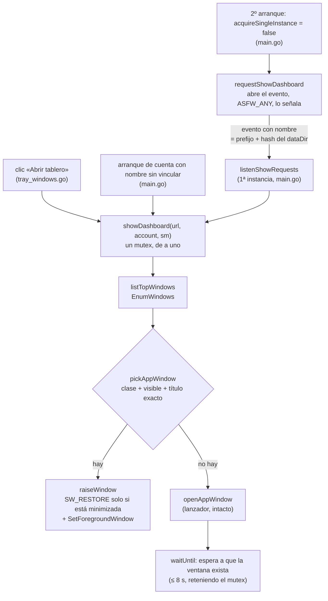

# T186 — un solo tablero por cuenta

Contrato: `ct-2026-11-11-095349`. Pedido del boss, verbatim (2026-11-11): «que solo se
abra 1 dashboard del mismo piumy».

## Qué pasaba

Cada clic en «Abrir tablero» de la bandeja lanzaba `msedge --app=<url>` (o chrome, o
`rundll32`) sin mirar si ya había una ventana: dos clics, dos ventanas. La apertura de
arranque de una cuenta con nombre sin vincular hacía lo mismo. Y un segundo arranque
de Piumy (el menú Inicio con Piumy corriendo) salía en silencio: quien lo pulsó no veía nada.

## Flujo

## Decisiones (y por qué)

- **Se busca por título, a propósito.** Las otras salidas no sirven: leer la URL de la
  ventana exige el árbol de accesibilidad de Chromium o su AppUserModelID (no documentado
  y no medible sin una ventana real); un `--user-data-dir` propio por cuenta pierde el
  login y el idioma del tablero; recordar el HWND que se lanzó muere con el proceso, y la
  auto-actualización reinicia Piumy con la ventana vieja abierta, justo el caso.
- **Coincidencia exacta de título.** `Piumy Gateway` (cuenta default) no choca con
  `Piumy Gateway — cuenta-2`, ni cuenta-2 con cuenta-3: cada cuenta su ventana. Y la clase
  `Chrome_WidgetWin_1` (msedge y chrome) evita traer al frente un Explorador abierto en una
  carpeta llamada «Piumy Gateway». Con dos ventanas viejas abiertas gana la de más arriba
  del z-order (EnumWindows va de arriba hacia abajo).
- **Dos títulos aceptados: el label y el id de la cuenta.** La página pinta el label (nombre
  de WhatsApp + cola del número) cuando lo conoce; una ventana abierta antes de que llegara
  el nombre sigue con el id unos segundos hasta su próximo sondeo de `/api/status`.
- **El formato del título NO se escribe de nuevo en el buscador:** `showDashboard` reusa
  `trayTitle`. Sigue habiendo tres sitios que arman `Piumy Gateway — <label>` (la bandeja,
  el `<title>` que sirve `restapi/dashboard.go` —con su propio test— y `app.js`
  `applyAccountIdentity`); `TestTrayTitleIsTheTitleAppJSPaints` ata el de la bandeja al
  literal de `app.js` y cae si uno cambia sin el otro.
- **Un mutex y una espera después de lanzar.** Un navegador en frío tarda segundos en mostrar
  su ventana; quien vuelve a pulsar «Abrir tablero» mientras tanto (o un 2º arranque) tiene
  que encontrarla, no lanzar otra. `showDashboard` retiene el mutex hasta que la ventana
  exista o pasen `windowAppearTimeout` (8 s), y por eso se llama en su propia goroutine.
- **El 2º arranque le pide al 1º que muestre su ventana** (agregado de Citrino): evento con
  nombre, mismo hash del `dataDir` que el mutex de instancia única, así cada cuenta
  alcanza solo a su instancia. Se abre, nunca se crea: sin oyente no queda nada colgado.
  El 2º proceso acaba de ser lanzado por el usuario y puede cederle el derecho al primer
  plano (`AllowSetForegroundWindow(ASFW_ANY)`); el 1º, que no recibió la última entrada, no
  podría tomarlo solo. El evento es de reinicio automático: lanzamientos seguidos se
  juntan en un pedido. Cualquier proceso de la sesión puede señalarlo, y lo único que
  consigue es que Piumy muestre su propio tablero (que pide su login): sin datos.
- **Linux/mac sin cambios:** `showDashboard` es `openAppWindow` y el evento es un no-op.

## Techos (declarados)

- **Solo ventanas `--app` de un navegador Chromium.** El tablero abierto en una pestaña de un
  navegador normal (su título lleva « - Microsoft Edge») o lanzado por el respaldo
  `rundll32` (navegador por defecto) no se detecta: se abre otra ventana, como antes.
- **Un 2º arranque en los segundos en que Piumy aún arranca** (antes de `listenShowRequests`,
  justo antes de la bandeja) no encuentra el evento y sale en silencio, como antes de T186.
- **Desfase de título:** cuando llega el nombre de WhatsApp, una ventana ya abierta tarda
  unos segundos en cambiar de título; el id de cuenta aceptado cubre ese tramo. Un cambio de
  nombre de perfil después de vincular deja otro tramo igual, sin cubrir.
- **Si el navegador nunca muestra una ventana que el buscador reconozca** (o la reconoce
  tras más de 8 s), `showDashboard` esperó en vano y el pedido siguiente lanza otra: es el
  comportamiento de antes de T186, no uno peor.

## No verificado (honesto)

- Que la ventana `--app` de Edge tenga clase `Chrome_WidgetWin_1` y que `GetWindowText`
  devuelva EXACTAMENTE `document.title`, sin sufijo. Una sonda de solo lectura sobre las
  ventanas reales (`EnumWindows` filtrando «Piumy», sin enfocar nada) la bloqueó el
  clasificador de permisos y no se rodeó. Si alguna de las dos suposiciones falla, el
  buscador no encuentra nada y se vuelve al comportamiento de antes. La prueba real va con
  la 0.13.1.
- Foco y restauración reales (`raiseWindow`), y el derecho al primer plano entre dos
  procesos (`ASFW_ANY`): solo se prueban con ventanas reales. Si Windows no deja traer la
  ventana, `raiseWindow` lo deja en el log (`Windows no dejó traer el tablero al frente`) y
  la barra de tareas la marca.
- El cableado de `main.go` y de `tray_windows.go` (`showDashboard` entero) no tiene test:
  mezcla ventanas reales. Se leyó el diff.
- La lectura de `minimized` solo la ejercita el test si el escritorio tiene alguna ventana
  minimizada en ese momento (si no, no hay nada que comparar y pasa); `visible` siempre (o se
  salta si el SO no informa ninguna ventana visible).
- `-race` (CGO apagado, sin gcc).

## Pruebas

`appwindow_windows_test.go`: `pickAppWindow` sobre un escritorio sintético (14 casos: otra
cuenta, default contra nombrada, prefijo, pestaña de navegador, otra clase, invisible,
minimizada, dos coincidencias, lista vacía); `listTopWindows` contra una ventana propia que
nunca se muestra (control de respuesta conocida: título y clase exactos, oculta, y listada
una sola vez); `visible`/`minimized` contra lo que el SO informa de esas mismas ventanas; la
deriva bandeja↔`app.js`; `waitUntil`. `singleinstance_windows_test.go`: el
evento real, un `dataDir` inventado por prueba (no alcanza a un Piumy corriendo): llega, un
pedido es UNA llamada y se oye el siguiente, no cruza entre cuentas, y un pedido sin oyente
no deja nada para el que llegue después. Ninguna abre una ventana visible (regla 20).

## Seguimiento (no se hizo; anotado)

**Una sola fuente del título: que Go decida y JS solo pinte.** Hoy el formato vive en tres
sitios y la guarda es un test. Lo de fondo es lo que ya se hace con `account_color`
(`app.js` solo pinta lo que Go calculó): una `config.DashboardTitle(label)` usada por la
bandeja, por `restapi/dashboard.go` y por el buscador, un campo en `/api/status` con ese
título, y `applyAccountIdentity` que lo pinte sin armarlo. Toca `app.js`, `restapi/read.go`
y `dashboard.go`; se dejó para cuando esos archivos estén libres de cambios ajenos.
