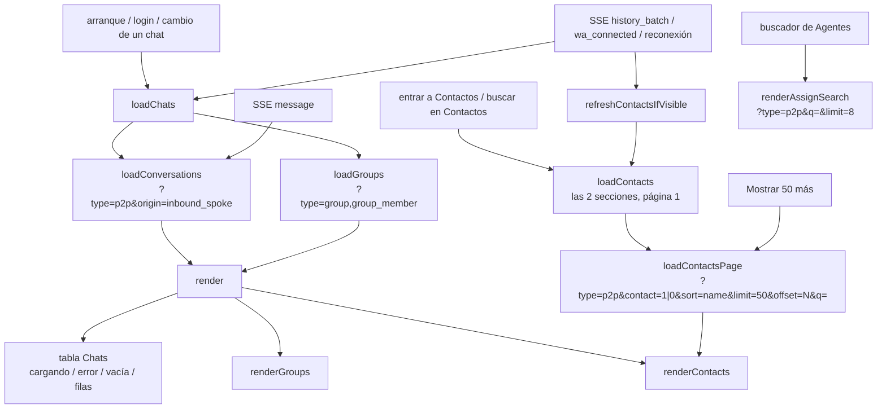

# T197 — el tablero como el demo 1

Contrato: `ct-2026-11-11-1144`. Origen: la revisión T192 (`PROPUESTAS.md` P1, P2, P3, P4 parte front y
P5), medida con el instrumento de T192 sobre datos 555. Demo elegido por el boss en T172:
`d1-ventana-light-desk.png`. Cuatro commits, cada uno medido:

1. P4 front: cada lista pide solo lo suyo a `GET /api/chats` (T198).
2. P2: una pantalla por sección.
3. P3 + P5: filas compactas, contadores con frases y salud con palabras.
4. P1: borradores legibles.

## 1 · Cada lista pide solo lo suyo (P4 front, sobre T198)

Antes, `loadChats()` traía `/api/chats` entero (en el Piumy real, 2.023 filas en ≈5 s; 788 KB en la base
555 de escala real) y lo separaba en el cliente. Lo pedía al arrancar, otra vez al abrir el SSE y otra
vez con **cada** mensaje que llegaba. Contactos dibujaba las 1.420 filas de una vez (45.581 px a 360 px).

Decisiones:

- **Un mensaje nuevo recarga solo las conversaciones.** Grupos no cambia con un mensaje: muestra nivel,
  agente, reglas y miembros, no el último texto.
- **Contactos se pide al entrar a la pestaña**, como Clientes: es cuando el dato tiene que ser de ahora, y
  así no se paga en el arranque. Con el buscador de esa pestaña el filtro es del servidor (mismo plegado
  de acentos que `foldAccents`, ver T198); Chats (≈13 filas en el real) y Grupos siguen filtrando en el
  cliente.
- **Las páginas avanzan por lo que el servidor ya entregó** (`offset += filas recibidas`), no por las filas
  que quedaron después de deduplicar por jid: una fila repetida entre páginas no hace que «mostrar más»
  vuelva a pedir lo mismo para siempre.
- **«Cargando…» no es «no hay nada».** Cada lista dice cuál de los dos es, y si el pedido falló, lo dice
  con un «Reintentar».
- Se fue el aviso de «límite de carga: 5000»: ya no hay una lista entera que pueda llegar cortada.
