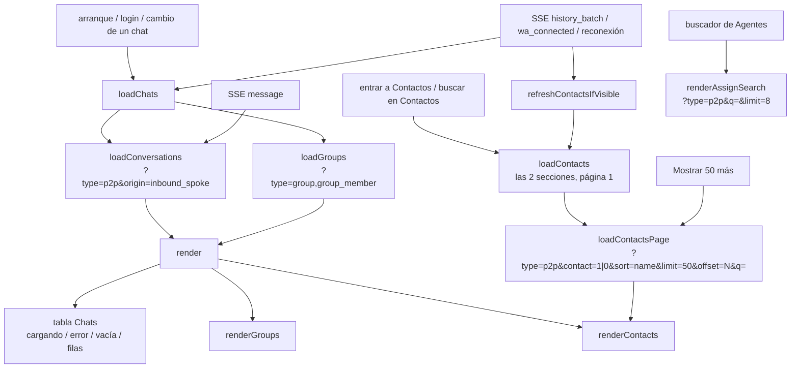
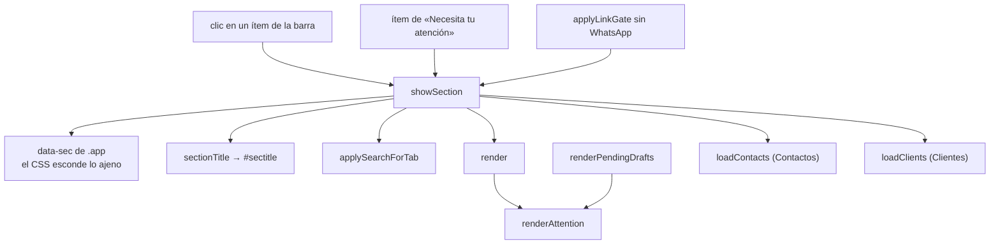

# T197 — el tablero como el demo 1

Contrato: `ct-2026-11-11-1144`. Origen: la revisión T192 (`PROPUESTAS.md` P1, P2, P3, P4 parte front y
P5), medida con el instrumento de T192 sobre datos 555. Demo elegido por el boss en T172:
`d1-ventana-light-desk.png`. Cuatro commits, cada uno medido:

1. P4 front: cada lista pide solo lo suyo a `GET /api/chats` (T198).
2. P2: una pantalla por sección.
3. P3 + P5: filas compactas, contadores con frases y salud con palabras.
4. P1: borradores legibles.

## 1 · Cada lista pide solo lo suyo (P4 front, sobre T198)

Antes, `loadChats()` traía `/api/chats` entero (en el Piumy real, 2.023 filas en ≈5 s; 788 KB en la base
555 de escala real) y lo separaba en el cliente. Lo pedía al arrancar, otra vez al abrir el SSE y otra
vez con **cada** mensaje que llegaba. Contactos dibujaba las 1.420 filas de una vez (45.581 px a 360 px).

Decisiones:

- **Un mensaje nuevo recarga solo las conversaciones.** Grupos no cambia con un mensaje: muestra nivel,
  agente, reglas y miembros, no el último texto.
- **Contactos se pide al entrar a la pestaña**, como Clientes: es cuando el dato tiene que ser de ahora, y
  así no se paga en el arranque. Con el buscador de esa pestaña el filtro es del servidor (mismo plegado
  de acentos que `foldAccents`, ver T198); Chats (≈13 filas en el real) y Grupos siguen filtrando en el
  cliente.
- **Las páginas avanzan por lo que el servidor ya entregó** (`offset += filas recibidas`), no por las filas
  que quedaron después de deduplicar por jid: una fila repetida entre páginas no hace que «mostrar más»
  vuelva a pedir lo mismo para siempre.
- **«Cargando…» no es «no hay nada».** Cada lista dice cuál de los dos es, y si el pedido falló, lo dice
  con un «Reintentar».
- Se fue el aviso de «límite de carga: 5000»: ya no hay una lista entera que pueda llegar cortada.

## 2 · Una pantalla por sección (P2, demo 1)

Antes, la barra tenía dos listas —«Vistas» (Resumen, Clientes) y «Conversaciones» (las seis
pestañas)— y cualquier ítem dibujaba **debajo del mismo Resumen** (identidad, contadores y salud:
≈600 px a 1440). Quedaban dos ítems marcados a la vez, y después de Clientes las pestañas conmutaban
paneles de una vista oculta: no se veía nada. Configuración y Privacidad vivían al pie de la salud,
debajo del primer pantallazo a 360/768.

Decisiones:

- **Una sola lista** en el orden del demo (Resumen, Chats, Grupos, Contactos, Clientes, Agentes,
  Reglas, Borradores), con sus íconos; en pantalla angosta, sin íconos, en una fila que se arrastra.
  `showSection` es el único lugar que cambia de pantalla.
- **La franja de arriba dice dónde estás** (el título de la sección) y deja Privacidad y Configuración
  siempre a la vista. Sin WhatsApp vinculado, Privacidad se va (no hay números que tapar);
  Configuración se queda (idioma y contraseña también antes de vincular).
- **El Resumen** = identidad + «Necesita tu atención» (borradores que esperan aprobación, chats sin
  atender; cada uno lleva a su sección; «Todo al día» solo cuando las dos cuentas llegaron) +
  contadores + salud. Cada sección de lista muestra solo su panel.
- **El buscador se queda pegado a la lista que filtra**, no sube a la franja como en el demo: en el
  teléfono, la franja fija le quitaría alto a la pantalla, y en las secciones sin búsqueda no hace
  nada.
- **El avatar del Resumen queda en 120 px**: su tamaño espera una respuesta del dueño (T116/T172b, ver
  `style.css`).
- **Sin WhatsApp, siempre el Resumen**: la barra se oculta, y quedarse en otra sección dejaría la
  página en blanco.
- «Drafts» pasa a «Borradores» en español, como en el demo.

**Revisión de diseño de P2** (impeccable critique + audit, a pedido del boss, y los principios de
apple-hig-expert; corrida en un solo contexto, sin subagentes de diseño):

- *Tomado:* en el teléfono la franja fija llegaba a tres renglones (≈125 px de 800 que no se van al
  bajar), con Privacidad y Configuración con su texto en un renglón propio. Ahora el título y los
  botones comparten el primero (los botones solo con su ícono, el texto sigue para el lector de
  pantalla) y el renglón vivo va debajo.
- *Tomado:* blancos táctiles de 44 px en el teléfono para los botones de la franja y los ítems de la
  barra; lo nuevo (franja, «Necesita tu atención») va en la grilla de 4/8 px; `aria-current="page"` en
  el ítem activo, para que el lector de pantalla diga dónde estás.
- *Ya estaba bien:* foco visible global (`:focus-visible`), movimiento reducido, colores por token
  claro/oscuro; los íconos y la flecha de cada ítem son `aria-hidden`.
- *Falso positivo del detector:* «exceso de rayas largas» en `index.html` — son los «—» que el tablero
  muestra a propósito cuando un dato no llegó (T172a), no prosa.
- *Queda para su commit:* los contadores «cola:» y «52 / 71» y la salud sin palabras (P5, commit 3); la
  fila de chat de 294 px en el teléfono (P3, commit 3); la fila de pestañas cortada sin señal de que
  hay más a 360 px (P9, T202).
