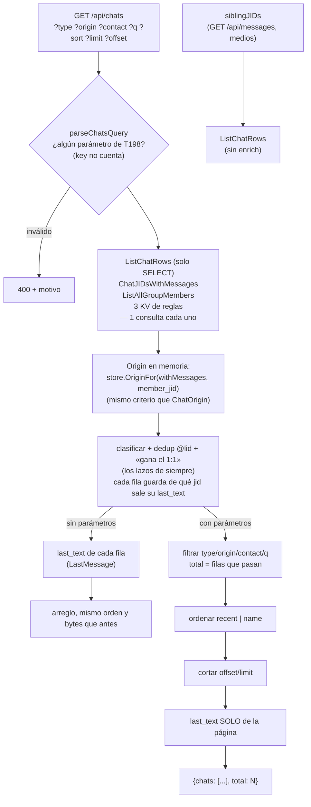

# T198 — la lista de chats llega por partes

Contrato: `ct-2026-11-11-1145`. Origen: la revisión T192 (propuesta P4), medida en el
Piumy real solo con GET: `/api/chats` devolvía 2.023 filas en ≈5 s y la pestaña Chats
tardaba de 5 a 15 s en pintar la primera fila, aunque usaba 13.

## Qué costaba

`ListChats(5000)` corría `enrichChat` en cada chat: `ChatOrigin` (1 o 2 consultas),
`LastMessage` y `LastOutboundModel`. De todo eso `chatOut` usa solo `Origin` y `LastText`.
`siblingJIDs` (abrir un chat en `GET /api/messages` y la descarga de medios) pagaba lo
mismo solo para comparar jids.

## Flujo

## Decisiones (y por qué)

- **Sin parámetros, la respuesta no cambia.** El tablero y la 0.13.x instalada piden
  `/api/chats?key=…`: `key` no activa el modo por partes. Lo prueba un test de
  caracterización (`testdata/chats-golden.json`) escrito sobre el código anterior.
- **Miembros de grupo y `withMessages` no se acotan a la página.** Deciden qué filas
  existen (dedup, «gana el 1:1», `group_discovered`) y el total. Son una consulta cada
  uno; lo que se acota es el trabajo por fila (`last_text`).
- **Offset, no cursor.** `last_ts` solo sube: una fila que sube de página llega a lo
  sumo repetida, nunca se pierde (el tablero deduplica por jid). Y permite «N de M».
- **La búsqueda pliega igual que `foldAccents` de app.js** (minúsculas, NFD, fuera
  U+0300..U+036F) sobre `contact_name`, `name`, el número del jid y el número resuelto.
