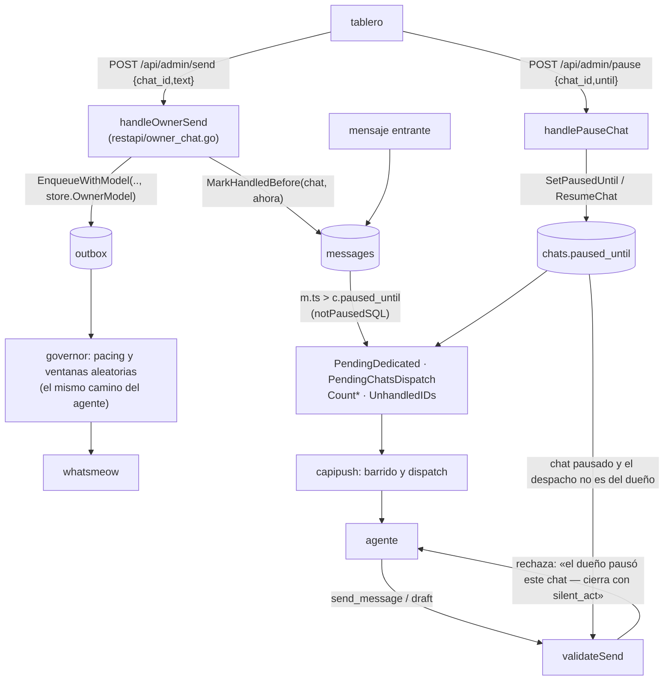

# T208-A — escribir como dueño y pausar al agente por chat (backend)

Contrato: `ct-2026-11-11-2206-t208`. Pedido del boss, verbatim (2026-11-11): «que se pueda
escribir y pausar al agente temporalmente o permanentemente (cambiar modo de contestación
y ajustes del chat, y que pueda ser una ventana independiente al dashboard)». Esta parte es
solo el backend; el front (caja para escribir, «Agente: activo ▾», ventana aparte) es la
parte B.

## Qué faltaba

La conversación del tablero era de solo lectura. REST ya tenía modo, nivel, reglas, memoria,
contexto e ignorar por chat, pero no había forma de **escribir como dueño** ni de **frenar al
agente en un chat un rato o para siempre** (la única pausa que existía, `clients.paused_until`,
es la de Clientes, otra cosa).

## Flujo

## Decisiones (y por qué)

- **La pausa es un piso sobre `messages.ts`, no un reloj ni una marca.** Un mensaje se
  despacha solo si `m.ts > chats.paused_until`. Mientras la pausa corre, todo lo que ya existe
  es `<=` su fin, así que una sola comparación cubre «pausado ahora»; al terminar una
  pausa temporal pasa solo lo que llegó después, y lo de la pausa nunca vuelve (lo atendió el
  dueño). No toca `handled` ni escribe en los mensajes: es reversible, no necesita que nada
  corra cuando la pausa vence, y se prueba sin reloj.
- **«Siempre» es `paused_until = 253402300799` (9999-12-31), no `SetActive(false)`.**
  Medido en `store/chat.go` (`SetActive`): al volver a activar barre con `MarkHandledBefore`
  lo anterior a la ventana de activación (escritura sobre datos del dueño) y encendería un
  chat que el dueño nunca tuvo encendido. Una pausa no toca la config del chat: reanudar
  deja exactamente lo que había. La fecha 9999 (y no `MaxInt64`) es para que el tablero la
  lea en JavaScript, cuyos enteros dejan de ser exactos en 2^53.
- **Reanudar mueve el piso a «ahora», no lo borra.** Si lo borrara, todo lo llegado durante
  la pausa se despacharía al reanudar. Solo actúa si la pausa está corriendo
  (`paused_until > ahora`): un chat nunca pausado o con la pausa ya vencida queda igual,
  porque subirle el piso tragaría mensajes que el agente sí debe contestar.
- **`until` ausente es 400, no 0.** `0` significa «sin fin»: un front que olvide el campo no
  puede silenciar un chat para siempre sin querer. Un `until` pasado o menor que -1 también es 400.
- **Una sola fuente del gate.** `notPausedSQL` entra en `pendingDedicatedWhere`, y
  `PendingDedicated` y `PendingChatsDispatch` dejaron de repetir esa condición en línea
  (T5/T67 ya costaron esa copia). `CountRecentPendingNonBoss` tiene la suya y suma la
  pausa a mano. `UnhandledIDs` también la honra: `dispatch()` revalida el burst con él (T196),
  así que una pausa que cae entre la lectura del barrido y el despacho lo frena.
- **El envío del dueño es el camino del agente, sin sus puertas de agente.** Entra al
  outbox, así el governor pacea y aleatoriza igual; no pasa por reglas, `policy_version` ni
  despacho (el dueño no es un agente). Cola primero, cierre después: si falla en el medio,
  como mucho un mensaje se contesta dos veces; nunca se pierde el del dueño Y se silencia
  al agente. `store.OwnerModel` (`"boss"`) es la etiqueta de lo que el dueño escribe en
  persona, desde el teléfono (T100) o desde el tablero: antes era una constante privada
  de `corepipeline`.
- **Campo `chat_id`**, como 11 de los 12 endpoints admin existentes (el brief decía `chat`).
- **Pausa en envíos del agente (`validateSend`).** La pausa frena el despacho, pero un `send_message` que el
  agente ya tenía en vuelo saldría igual en medio de la conversación del dueño. Se rechaza
  con una frase que dice que el dueño pausó el chat y que el turno se cierra con
  `silent_act`. Excepción: el despacho activo es del dueño (`LevelBoss`) **y no está
  consumido**. Un despacho consumido (`Done`) queda en memoria después de su turno: si
  eximiera, el agente principal (cuyo último turno del dueño casi siempre está ahí) cruzaría
  todas las pausas.

## Techos (declarados)

- **Granularidad de un segundo.** Un mensaje del mismo segundo que el envío o la reanudación
  queda como atendido. Y al enviar, lo que llegó mientras el dueño escribía queda cerrado
  (la cota es el instante de enviar), igual que `approve-draft`.
- **Reloj local contra reloj de WhatsApp.** El piso se compara con `messages.ts`, que viene de
  WhatsApp, y el piso nace del reloj de esta máquina; un desfase de segundos se come los
  primeros mensajes tras reanudar.
- **La segunda pieza de un turno del dueño** (texto y luego imagen) a un chat pausado se
  rechaza: la primera consumió el despacho. El dueño la reordena. Es el mismo trato que T170.
- **Un `send_message` que ya pasó `validateSend` y está encolando** no se frena: la ventana
  es de milisegundos.
- **El envío no se rechaza con WhatsApp desconectado ni con el mute puesto:** queda en el
  outbox hasta que se pueda. (`restapi.Deps` no tiene `Gateway`; el rechazo con mute pediría
  una clave i18n.)
- **Dos ventanas del tablero** no se enteran una de la otra: no se emite evento SSE (el front
  decide cuál escuchar).

## No verificado

- Contra WhatsApp real (envío de punta a punta con el governor vivo, y la hora de
  `messages.ts` de un mensaje recibido de verdad).
- Con el tablero de la parte B: todavía no hay front que llame a estos endpoints.

## Pruebas

- `store/pause_test.go`: las seis consultas de despacho honran el piso (cuatro bordes, cada una
  bajo su nombre), la pausa no toca `handled` ni la config del chat, `ResumeChat` en sus cuatro
  estados y que lo de la pausa no vuelve, pausar un chat inexistente no lo crea.
- `restapi/owner_chat_test.go`: envío (cola con la etiqueta del dueño, texto recortado, cierra
  lo pendiente hasta ahora pero no lo posterior), cinco rechazos que no encolan ni cierran, los
  tres valores de `until` y seis rechazos que no cambian nada, `paused_until` en `GET /api/chats`.
- `mcpserver/pausedsend_test.go`: despacho propio del chat pausado → rechaza (y `silent_act`
  cierra el turno); despacho del dueño → pasa; despacho del dueño ya consumido → rechaza; sin
  despacho: pausa con fin y sin fin → rechaza, pausa vencida y nunca pausado → pasa.
- `capipush/pausedchat_test.go`: tres barridos reales (el pausado no sale, el otro sí; lo de
  durante la pausa no vuelve; un mensaje posterior sale solo) y el burst viejo del barrido
  frenado por una pausa que cae después (con el mismo burst sin pausa como control).
