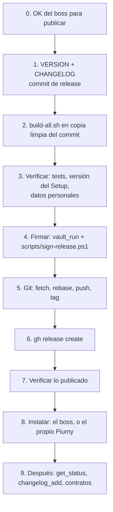

# Manual de release de Piumy

Cómo sale una versión, en orden. Cada paso trae el comando exacto y cómo se
comprueba que quedó bien. Quien publica es Citrino; este documento es lo que hay
que seguir, no lo que hay que recordar.

Contrato: `ct-2026-11-11-0201-t183`. La firma existe por T176
(`docs/T176-AUTOUPDATE.md`, que explica el porqué): **una release sin
`SHA256SUMS` + `SHA256SUMS.sig` firmados nunca se instala sola** en ninguna
instalación. Una release sin firma es una release que obliga a actualizar a mano.



Todos los comandos se corren en **Git Bash**, desde `coderoot/` (el repo git propio,
rama `master`), salvo los que dicen `pwsh`. Los placeholders `<v>` son la versión
`x.y.z`, p. ej. `0.13.0`.

## 0. Precondiciones

- **OK del boss para publicar.** Cada `push` y cada `gh release create` necesita
  su propio OK (constitución §1 y §6): el de una versión no vale para la siguiente.
- **La clave de release existe y su pública está puesta.** `internal/autoupdate/pubkey.go`
  tiene `releasePublicKey` con valor, commiteada. Comprobar:

  ```bash
  grep -n '^const releasePublicKey' internal/autoupdate/pubkey.go
  ```

  Si sale `= ""`, **detener**: con la constante vacía los binarios nacen sin poder
  verificar nada, y ninguna instalación se actualiza sola desde esa versión. La clave
  la genera el boss (`go run ./cmd/signrelease keygen`); la línea `PRIVADA` va al vault
  y a ningún otro lado, la `PUBLICA` va a `pubkey.go`.
- **El módulo del vault con la clave privada existe:** «Piumy firma», id
  `a110eebc96264bc1b0bd0d3977578331`, variable `PIUMY_FIRMA`, acceso `popup` (la bóveda
  pide la contraseña del boss en cada firma). Creado el 2026-11-11; su pública es la de
  `pubkey.go`. Lo comprueba `vault_list` (sale el nombre, nunca el valor).

## 1. VERSION, CHANGELOG y el commit de release

`VERSION` (raíz de `coderoot/`) es la única fuente del número; nadie lo escribe a
mano en otro lado.

1. Editar `VERSION` con la versión nueva (una línea, `x.y.z`).
2. Agregar arriba de `CHANGELOG.md` la sección `## <v> — AAAA-MM-DD`, con el formato
   de las anteriores (`### Changed`, `### Added`, `### Fixed`; cerrada con `---`).
   Ese texto es también el de la release en GitHub (paso 6).
3. Sincronizar la copia que embebe el binario (`go:embed` no cruza directorios) y
   commitear **solo estas tres rutas** (el árbol es compartido: nunca `git add .`):

   ```bash
   cp VERSION internal/version/VERSION
   git status --short                      # leerlo entero: lo que no es tuyo no se agrega
   git commit -m "release: Piumy Gateway <v> — <resumen en una línea>" -- VERSION CHANGELOG.md internal/version/VERSION
   ```

   Es el formato del commit de la 0.12.5 (`cddfa39`: exactamente esos tres archivos).

**Se comprueba:** `git show --stat HEAD` muestra solo esas tres rutas y
`cat VERSION internal/version/VERSION` da el mismo número dos veces.

## 2. Armar `dist/` — desde una copia limpia del commit

`build-all.sh` compila lo que hay en el árbol, no lo que hay en el commit. En la carpeta
compartida eso incluye el trabajo a medias de otros agentes: así se publicaría un binario
que nadie revisó. Se arma desde una copia exacta del commit:

```bash
BUILD="$(mktemp -d)"                          # fuera del repo
git archive HEAD | tar -x -C "$BUILD"
(cd "$BUILD" && bash build-all.sh)            # ~2 min; hay que correrlo en Git Bash
mkdir -p dist && cp "$BUILD"/dist/* dist/     # dist/ está en .gitignore
rm -rf "$BUILD"
```

Necesita Go y **Inno Setup 6** (`ISCC.exe`: en el `PATH`, o en
`%LOCALAPPDATA%\Programs\Inno Setup 6`). Sin ISCC el script sale con error pero deja
los binarios; el Setup no se arma.

**Qué produce, medido** (build real de la 0.12.5 en una copia limpia del commit, 2 min 8 s,
Windows con Inno Setup 6): siete archivos en `dist/`.

| Archivo | Qué es | ¿Se publica? |
|---|---|---|
| `Piumy-Setup-<v>.exe` | instalador de Windows (Inno Setup), ~18 MB | sí |
| `Piumy-<v>-linux-amd64.tar.gz` | binario + `install.sh` + `eula.txt` | sí |
| `Piumy-<v>-linux-arm64.tar.gz` | ídem | sí |
| `Piumy-<v>-linux-armv7.tar.gz` | ídem | sí |
| `Piumy-<v>-darwin-amd64.tar.gz` | ídem | sí |
| `Piumy-<v>-darwin-arm64.tar.gz` | ídem | sí |
| `piumy-gateway-windows-amd64.exe` | el binario que empaqueta el Setup, ~39 MB | **no** |

El `.exe` suelto se queda en `dist/` porque el script de firma lo usa (comprueba que
lleva la clave pública), pero no va a la release. Cada `tar.gz` trae tres archivos dentro
de `Piumy-<v>-<plataforma>/`: `piumy-gateway`, `install.sh`, `eula.txt`.

`dist/` también guarda los paquetes de versiones anteriores: no estorban, los
scripts siempre nombran la versión.

**Se comprueba:**

```bash
ls dist/Piumy-Setup-<v>.exe dist/Piumy-<v>-*.tar.gz dist/piumy-gateway-windows-amd64.exe   # 7 archivos
tar -tzf dist/Piumy-<v>-linux-amd64.tar.gz                                                  # 3 archivos
pwsh -NoProfile -Command "(Get-Item dist/Piumy-Setup-<v>.exe).VersionInfo.ProductVersion"   # <v>
```

## 3. Verificar antes de firmar

1. **Tests**, sin caché y en limpio:

   ```bash
   go build ./... && go vet ./... && go test ./... -count=1
   ```

   Tiene que terminar sin una sola línea `FAIL`. Un test que falla a veces
   (flaky) no se re-corre hasta que pase: se anota y se avisa.
2. **Versión del Setup** = `<v>`: el tercer comando de la comprobación del paso 2.
3. **Escaneo de datos personales (constitución §2b)**, sobre el árbol **y** el historial.
   Tiene que salir **vacío**, los tres. Este repo se publica: lo que entra al historial
   queda público para siempre.

   ```bash
   # El árbol, y los nombres de archivo de secretos que alguna vez entraron al historial
   # (los mismos 4 patrones que .githooks/personal-data-patterns.sh usa en pre-commit):
   git grep -nP '(?<![0-9])(?!555)[0-9]{7,}@(lid|s\.whatsapp\.net|c\.us|g\.us)|(NewJID\(|JID\{User:[[:space:]]*)"(?!555)[0-9]{7,}"|(?<![0-9+])\+(?!555)[0-9]{1,3} ?[0-9]{6,12}(?![0-9])|(?<![0-9])\+?56 ?9(?!55) ?[0-9]{8}(?![0-9])' -- .
   git log --all --pretty=format: --name-only --diff-filter=A | sort -u | grep -iE "secrets?/|credentials?/|\.env"

   # El CONTENIDO de todo el historial (los dos de arriba no lo miran):
   git log --all -p --no-color | grep -aP '(^|[^0-9])(?!555)[0-9]{7,}@(lid|s\.whatsapp\.net|c\.us|g\.us)|(NewJID\(|JID\{User:[[:space:]]*)"(?!555)[0-9]{7,}"|(^|[^0-9+])\+(?!555)[0-9]{1,3} ?[0-9]{6,12}(?![0-9])|(^|[^0-9])\+?56 ?9(?!55) ?[0-9]{8}([^0-9]|$)'
   ```

   Medido el 2026-11-11 (HEAD `fcac40f`, 49 commits): los tres vacíos; el último tarda ~4 s.
   Comprobado que el patrón puede dar positivo: `printf '%s@s.whatsapp.net\n' 1234567890 | grep -cP '<patrón>'`
   da 1, y con `555000001` en vez de `1234567890` da 0. (El número va como argumento aparte
   a propósito: escrito junto al dominio, este mismo manual dispararía el hook de pre-commit.)

   **El buscador solo busca formas, no datos.** No ve nombres de personas sueltos, ni un
   teléfono de otro país escrito sin `+` en texto plano. Antes de publicar se **lee** el
   diff de lo que sale: `git log -p origin/master..HEAD`. Si algo aparece, no se publica
   (la regla de qué hacer está en la constitución §2b).

## 4. Firmar

Es lo que hace que las instalaciones puedan actualizarse solas. Lo corre Citrino con
`vault_run`; la clave privada llega **solo** como `PIUMY_RELEASE_SIGNING_KEY` en el
entorno del proceso, nunca por argumento ni por disco.

```
vault_run(
  script: "coderoot/scripts/sign-release.ps1",
  args:   ["<v>"],
  env:    [{ name: "PIUMY_RELEASE_SIGNING_KEY", module_id: "a110eebc96264bc1b0bd0d3977578331", line: "PIUMY_FIRMA" }]
)
vault_run_status()      # exited, exit_code 0; leaked_in_output [] y leaked_to_disk [] con sweep_complete true
```

`vault_run` pide que el boss apruebe el script la primera vez y cada vez que cambia.

**Qué hace el script**, en este orden, y falla con un mensaje claro en cada uno:

1. la versión es `x.y.z` y está la variable `PIUMY_RELEASE_SIGNING_KEY`;
2. `releasePublicKey` de `pubkey.go` no está vacía;
3. están en `dist/` el Setup y los `tar.gz` de esa versión (la lista de plataformas la lee
   de las llamadas `package` de `build-all.sh`: una plataforma nueva se firma sola);
4. el `piumy-gateway-windows-amd64.exe` de `dist/` **contiene** la pública de `pubkey.go`
   (si no, `dist/` se armó antes de ponerla: la release saldría firmada pero sus binarios
   no podrían verificar nada);
5. corre `go run ./cmd/signrelease sign dist …`, y la pública que imprime tiene que ser
   la de `pubkey.go`.

Si algo falla, **borra `dist/SHA256SUMS` y `dist/SHA256SUMS.sig`**: no queda un par viejo o
a medias que se pueda subir por error. Cuando termina bien imprime
`OK: 6 paquetes firmados…` y deja los dos archivos.

**Se comprueba:** `exit_code 0`, la línea `OK:`, y
`ls dist/SHA256SUMS dist/SHA256SUMS.sig`. `SHA256SUMS` lista exactamente 6 archivos
(el Setup y los 5 `tar.gz`), uno por línea, `<sha256>  <nombre>`:

```bash
wc -l < dist/SHA256SUMS      # 6
```

**Nunca** pegar la clave en una terminal, en un `.env` ni en un argumento. Si el script se
corre sin `vault_run`, falla en el paso 1 por falta de la variable: es lo esperado.

## 5. Git: fetch, rebase, push, tag

**CLEVER.CAT también publica en este `master`** (la carpeta `web/`: el sitio piumy.app vive
en este repo). Por eso el `push` puede encontrar commits que no están acá: se trae y se
rebasea **antes**, y se mira qué entra.

```bash
git fetch origin
git log --oneline origin/master..HEAD          # lo que se va a publicar: leerlo entero
git log --oneline HEAD..origin/master          # lo que llegó de otros (p. ej. web/): tiene que poder rebasearse
git rebase origin/master                       # solo si lo anterior trajo algo
git status --short                             # nada tuyo sin commitear
```

Si el rebase cambia el commit de release, lo armado en `dist/` sigue valiendo **solo si el
código es el mismo**: `git diff <HEAD-anterior> HEAD --stat` no debe tocar nada fuera de
`web/`. Si toca código, se vuelve al paso 2.

Con el **OK del boss para este push** (precondición del paso 0):

```bash
git tag -a v<v> -m "Piumy Gateway <v>"          # anotado, como v0.12.4 y v0.12.5
git push origin master v<v>
```

**Se comprueba:** `git ls-remote origin master "refs/tags/v<v>*"` muestra el mismo commit
que `git rev-parse HEAD` y `git rev-parse "v<v>^{commit}"`.

## 6. Publicar la release

El título es `Piumy Gateway <v>`; el cuerpo es la sección del CHANGELOG de esa versión
(es lo que tiene la release de la 0.12.5). Los 8 archivos: el Setup, los 5 `tar.gz`,
`SHA256SUMS` y `SHA256SUMS.sig`. **No** el `.exe` suelto.

```bash
V=<v>
NOTES="$(mktemp)"
awk -v v="$V" '$0 ~ "^## "v" " {f=1; next} f && /^---$/ {exit} f' CHANGELOG.md > "$NOTES"
test -s "$NOTES" || echo "ERROR: el CHANGELOG no tiene sección para $V"

gh release create "v$V" \
  "dist/Piumy-Setup-$V.exe" dist/Piumy-"$V"-*.tar.gz dist/SHA256SUMS dist/SHA256SUMS.sig \
  --repo clevercat64/Piumy --title "Piumy Gateway $V" --notes-file "$NOTES" \
  --verify-tag --latest
rm -f "$NOTES"
```

`--title` y `--notes-file` evitan que `gh` pregunte (en una terminal de agente se queda
colgado esperando). `--verify-tag` aborta si el tag no llegó al remoto (paso 5).

## 7. Verificar lo publicado

El actualizador exige tres cosas de cada release: la firma, el `digest` que GitHub
calcula por asset, y el SHA-256 real del archivo. Se mira todo, bajando lo publicado:

```bash
V=<v>
D="$(mktemp -d)"
gh release download "v$V" --repo clevercat64/Piumy --dir "$D"

# a) los archivos bajados son los de SHA256SUMS (6 líneas, todas OK)
(cd "$D" && sha256sum -c SHA256SUMS)

# b) GitHub muestra su digest en CADA asset y coincide con SHA256SUMS. Sin salida = bien.
gh api "repos/clevercat64/Piumy/releases/tags/v$V" \
  --jq '.assets[] | select(.name != "SHA256SUMS" and .name != "SHA256SUMS.sig") | "\(.digest | sub("sha256:";""))  \(.name)"' \
  | LC_ALL=C sort -k2 | diff - <(LC_ALL=C sort -k2 "$D/SHA256SUMS") && echo "digests de GitHub == SHA256SUMS"

# c) los 8 assets están, y la release es la última
gh api "repos/clevercat64/Piumy/releases/latest" --jq '.tag_name, (.assets | length)'   # v<v> y 8
rm -rf "$D"
```

Si algún asset sale sin `digest` (GitHub lo calcula unos segundos después de la subida),
`jq` falla en voz alta: esperar un minuto y repetir. **Una release donde falte un digest
no se instala sola**, y no hay forma de repararla sin volver a subir ese asset.

La firma no se puede comprobar suelta (no hay un `signrelease verify`): la prueba final es
una instalación real, en el paso 8.

## 8. Instalar

- **En la máquina del boss, la instala el boss**, o —desde la 0.13.0, que trae el
  actualizador— el propio Piumy, solo, cuando no hay mensajes pendientes. Las instalaciones
  anteriores (≤ 0.12.5) no traen el actualizador y se actualizan a mano **una** vez.
- **NUNCA desde la pestaña de un agente.** CleverCoder mete cada pestaña en un Job de
  Windows con `KILL_ON_JOB_CLOSE`: lo que el Setup arranca vive dentro de ese Job, y
  Piumy muere al cerrar la pestaña (medido en T176).
- **NUNCA lanzar un Setup desde Git Bash.** MSYS reescribe los argumentos que empiezan con
  `/` y rompe `/VERYSILENT`.

**Se comprueba**, en la instalación que se actualizó, `GET /api/update` (con la sesión del
tablero): `current` igual a `<v>`. Si la instalación no se actualiza, ahí mismo dice por qué
(`blocked`), y el log guarda el motivo.

## 9. Después

1. `get_status` (MCP de Piumy) muestra la versión nueva.
2. `changelog_add` (MCP `clevercoder-features`) registra qué se agregó, cambió y arregló.
3. Contratos: cerrar los que cubría la release (`contracts_close` lo decide Citrino) y avisar
   al boss con el enlace de la release.
4. Si hubo un paso que no se pudo hacer tal cual está escrito acá, **se corrige este manual
   en el mismo turno**: lo que se esquiva en silencio lo vuelve a pisar el siguiente.

## Qué se midió y qué no

Medido para este manual (2026-11-11): el build de `build-all.sh` en copia limpia (7 archivos,
2 min 8 s); el contenido de los `tar.gz`; la versión del Setup (`ProductVersion`); que la
pública queda como bytes planos dentro del `.exe` (con la constante vacía, 0 apariciones; con
ella, 1); los tres escaneos de datos personales (vacíos, con control positivo); la
descarga de un asset real con `gh release download` y que `digest` de la API coincide con su
SHA-256; el comando que arma las notas desde el CHANGELOG; y `scripts/sign-release.ps1`, con
una clave de prueba y un `dist/` falso (cuatro casos del contrato y tres más).

**No medido:** la corrida real con `vault_run` y la clave real (la hace Citrino la primera
vez); `gh release create` (publica de verdad); el rebase con commits de `web/` (depende de
lo que haya llegado); `get_status`/`changelog_add` (se hacen al cierre); y la instalación por
el propio actualizador de Piumy (ninguna release firmada existe todavía).
